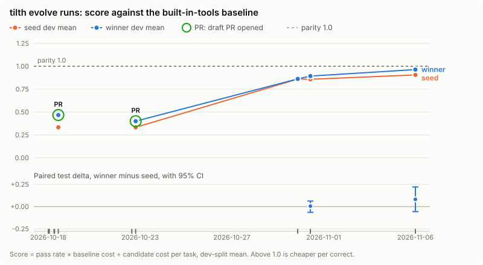

# tilth (experimental fork)

tilth is a Rust CLI and MCP server that gives coding agents tree-sitter outlines, symbol search, callers, and tag-checked file edits.

> [!WARNING]
> **This repository is an experimental fork of [jahala/tilth](https://github.com/jahala/tilth).**
> The fork lives at [paulnsorensen/tilth](https://github.com/paulnsorensen/tilth).
>
> - Interfaces, prompts, and output formats change without notice.
> - The fork makes no stability or compatibility promise.
> - An automated evolve loop writes much of the prompt text and some source changes.
> - If you need a stable tool, use [upstream tilth](https://github.com/jahala/tilth).

## Contents

- [How this fork differs from upstream](#how-this-fork-differs-from-upstream)
- [Install](#install)
- [MCP server](#mcp-server)
- [Launcher and preamble](#launcher-and-preamble)
- [Shell guard hook](#shell-guard-hook)
- [CLI](#cli)
- [Benchmarks](#benchmarks)
- [Benchmark log](#benchmark-log)
- [Relationship to upstream](#relationship-to-upstream)
- [Credits and license](#credits-and-license)

## How this fork differs from upstream

These differences are permanent. A sync from upstream keeps the fork side.

| Area | This fork | Upstream |
|---|---|---|
| Edits | `tilth_write` takes a JSON `edits` array of `{path, tag, ops}` sections. A whole-file tag binds each edit to the content you saw. A changed file gets a 3-way merge, and the section fails only on a conflict. | A different `tilth_write` edit surface. |
| Paths | Every path-taking MCP tool requires `cwd`. A relative path anchors under `cwd`, and the server refuses `..`. The server uses an absolute path as given. The server does not use the MCP roots handshake. | An optional `root` argument. |
| Server mode | The MCP server always registers `tilth_write`. It has no read-only mode. The server accepts `--edit` and ignores it. | Read-only and edit modes. |
| Removed commands | No `tilth diff`, `tilth overview`, or `tilth --map`. Use `git diff`, `git log`, `ls`, and `find`. | Present. |
| Removed tools | No `tilth_grok` MCP tool and no `tilth grok` command. | Present. |
| Version | The version is always `0.0.0-experimental`. `tilth --version` prints `tilth 0.0.0-experimental+<commit>`, so the commit identifies the build. The fork has no tagged releases. | Semantic versions with tagged releases. |

## Install

`cargo install tilth` and `npx tilth` install **upstream** tilth, not this fork.
The `install.sh` script and the jahala releases page also give upstream binaries.

Use one of these fork paths.

### Build from source (recommended)

```bash
cargo install --git https://github.com/paulnsorensen/tilth
```

From a local checkout:

```bash
cargo install --path .
```

Both commands put `tilth` in `~/.cargo/bin`.

### Nightly npm package

The nightly workflow publishes `@paulnsorensen/tilth-nightly` from `main`. Its `latest` dist-tag points at the newest build.

```bash
npx --yes @paulnsorensen/tilth-nightly@latest --version
```

When you run `tilth install <host>` from this package, the config entry is `npx @paulnsorensen/tilth-nightly --mcp`. The `--hook` entry uses the same `npx` form.
This entry has no version pin, so it can run a new nightly each time the host starts.
For a fixed binary, build from source.

## MCP server

Register tilth with your agent host:

```bash
tilth install claude-code     # writes ~/.claude.json
tilth install codex           # writes ~/.codex/config.toml
```

`tilth install` supports 22 hosts. [docs/hosts.md](docs/hosts.md) lists each host and its config file.
The entry runs `<path-to-tilth> --mcp`, a JSON-RPC server on stdio. From an npm install, the entry runs `npx <package> --mcp`, where `<package>` is the npm package that holds the binary.

The server has three tools. Each tool requires `cwd`, the absolute path of your checkout.

| Tool | Use |
|---|---|
| `tilth_read` | Read files. Takes `paths` such as `src/a.rs`, `src/a.rs#12-40`, `src/a.rs#parse`, or `README.md### Install`. Small files come back whole. Large code files come back as an outline. |
| `tilth_search` | Find symbols, text, and regexes. Takes `queries`. An entry can also be an ast-grep `pattern` or a `follow` entry that fetches callers, callees, siblings, or tests. |
| `tilth_write` | Edit files. Takes `edits` with the tags that reads and searches print. |

The served instructions and tool descriptions are in [prompts/](prompts/). [AGENTS.md](AGENTS.md) is a copy of the instructions.
[docs/mcp.md](docs/mcp.md) describes the edit model and structural search in more detail.

### Tool gating

A tool description alone does not make an agent use `tilth_write`. Remove the host tools that overlap with tilth instead.
In a Claude Code subagent, list the tools you allow and leave out `Edit`, `Write`, `Grep`, and `Glob`:

```yaml
# .claude/agents/coder.md frontmatter
tools: Bash, Read, ToolSearch, mcp__tilth
```

For headless runs, use `claude --disallowedTools "Grep,Glob"`.

## Launcher and preamble

`tilth claude` and `tilth codex` start the harness with the tilth preamble as its system prompt. The preamble is [prompts/preamble.md](prompts/preamble.md).

```bash
tilth claude -p "find where handleAuth is defined"   # runs: claude --system-prompt-file <F> -p ...
tilth codex exec "summarize src/auth.ts"             # runs: codex -c model_instructions_file="<F>" exec ...
```

- `<F>` is `$XDG_CACHE_HOME/tilth/preamble-<hash>.md`. When `XDG_CACHE_HOME` is not set, the directory is `~/.cache/tilth/`.
- The launcher writes only in that directory. It does not change host config files.
- The launcher does not register the MCP server. Run `tilth install claude-code` or `tilth install codex` first.
- `claude` or `codex` must be the first argument. `tilth --json claude` is a usage error (exit 2).
- All later arguments pass to the harness unchanged.
- The launcher adds the preamble to every call, management subcommands such as `claude mcp` and `codex login` included.
- On Windows, the launcher starts only a native `claude.exe` or `codex.exe`. It does not start an npm `.cmd` shim.
- If you give `--system-prompt` or `--system-prompt-file` (claude), or a `model_instructions_file` override (codex), the launcher adds nothing. Arguments after `--` do not count.
- On Unix, the launcher refuses a cache directory that is not a real directory, that another user owns, or that all users can write.
- `tilth codex` exits 1 when the cache path is not valid UTF-8.
- To search for the word `claude` or `codex`, run `tilth -- claude`.

To use the preamble in another harness:

```bash
tilth preamble >> AGENTS.md                               # add it to project instructions
claude --append-system-prompt "$(tilth preamble)"         # add it after the built-in prompt
<harness> --system-prompt-file "$(tilth preamble --path)" # give the cache file to a harness
```

`tilth preamble --path` writes the cache file and prints its path.

## Shell guard hook

`tilth hook` reads one pre-tool event on stdin. It exits 2 to deny shell file reads, searches, and writes such as `cat`, `grep`, and `sed -i`. The deny message names the tilth tool to use.

```bash
tilth install claude-code --hook
```

`--hook` writes the MCP config and adds one tilth entry to the host's hook file. A second run replaces that entry and keeps your other hooks.
Seven hosts support `--hook`: `claude-code`, `codex`, `droid`, `crush`, `augment`, `cursor`, and `windsurf`.
[docs/hosts.md](docs/hosts.md#shell-guard-hook) gives the hook file, fail-closed behavior, and removal steps for each host.

> [!IMPORTANT]
> For `claude-code`, the entry sets `onFailure: "block"`.
> If the binary moves or disappears, the hook blocks every Bash call until you reinstall or remove the entry.

### Bash guard hook

[scripts/tilth-bash-guard](scripts/tilth-bash-guard) is an older Python guard for Claude Code. It sends `grep`, `rg`, and `cat` reads of project files to the tilth tools.
The guard does not catch these forms:

- A command inside a wrapper such as `bash -c '...'`.
- A pipe filter such as `cargo test | grep foo`.
- A path outside the project.

Read the script before you install it. Run its self-test first:

```bash
python3 scripts/tilth-bash-guard --self-test
```

To install it, add it to `.claude/settings.json` in a tilth-enabled project:

```json
{
  "hooks": {
    "PreToolUse": [
      {
        "matcher": "Bash",
        "hooks": [
          {"type": "command", "command": "python3 \"$CLAUDE_PROJECT_DIR\"/scripts/tilth-bash-guard"}
        ]
      }
    ]
  }
}
```

## CLI

```bash
tilth <path>                      # read a file (outline if large, on a terminal)
tilth <path> --section 45-89      # line range, grown to the end of a cut function
tilth <path> --section "## Foo"   # markdown section
tilth <path> --full               # whole file
tilth <symbol> --scope <dir>      # definitions and usages
tilth <symbol> --expand=5         # inline source for the top 5 matches
tilth <symbol> --callers          # call sites (structural)
tilth "TODO: fix" --scope <dir>   # text search
tilth "/<regex>/" --scope <dir>   # regex search
tilth "*.test.ts" --scope <dir>   # glob
```

When stdout is not a terminal, a file read returns the whole file.
[docs/cli.md](docs/cli.md) has all flags and real output samples.

## Benchmarks

The numbers in upstream's README are upstream measurements. They do not describe this fork.

The fork measures **cost per correct answer** against Claude Code with its built-in tools. The method is in [benchmark/README.md](benchmark/README.md).
The current results do not show that the fork is cheaper than the built-in tools. The work continues.

- **Stock-prompt A/B (2026-11-02).** 18 tasks, 3 reps, Sonnet. Every tilth arm costs 11.6% to 15.6% more per correct answer than the built-in-tools baseline. All three cost intervals exclude 0. The tilth arms solve 52 or 53 of 54 cells; the baseline solves 54.
- **tools-sonnet-r1 evolve round (2026-11-06).** On the held-out test split (8 tasks, 4 reps), the winning candidate scores 0.938 and the seed scores 0.812. The paired interval [-0.057, 0.220] includes 0, so no change shipped.
- **gepa-v3 campaign (October 2026).** On the held-out test split, the campaign's last measured `main` costs 2% to 6% less per correct answer than the baseline. On the dev split, the result is within noise.

Source: [.hallouminate/wiki/benchmark-gepa-v3-evolve.md](.hallouminate/wiki/benchmark-gepa-v3-evolve.md). The cost causes are in [.hallouminate/wiki/stock-ab-trajectory-diagnosis.md](.hallouminate/wiki/stock-ab-trajectory-diagnosis.md).

## Benchmark log

<picture>
  <source media="(prefers-color-scheme: dark)" srcset="benchmark/log/evolve-dark.svg" />
  <source media="(prefers-color-scheme: light)" srcset="benchmark/log/evolve.svg" />
  
</picture>

The chart shows the evolve runs over time. Each run scores tilth candidates against the built-in-tools baseline.
A score of 1.0 is cost-per-correct parity with the baseline. A score above 1.0 is cheaper per correct answer.
Every evolve run uses a Sonnet agent model. Each band of the chart names its task panel and the resolved model.
Scores from different panels or models do not compare, so a divider separates the bands and no line joins them.
A table under the chart gives the real numbers per band: the dev-split pass rate and cost per correct answer of
the baseline (built-in tools, no tilth), the tilth seed, and the tilth winner.
Each evolve run adds one entry to [benchmark/log/evolve.jsonl](benchmark/log/evolve.jsonl) and redraws the chart.
The evolve loop is a GEPA search over tilth commits, which change prompt texts and `src/**`. See [benchmark/evolve/README.md](benchmark/evolve/README.md#benchmark-log).

## Relationship to upstream

- **Upstream to fork.** Upstream changes come in on a `sync/upstream-<date>` branch. Conflicts resolve to the fork side for the differences above.
- **Fork to upstream.** A weekly routine finds self-contained fork changes and opens pull requests against `jahala/tilth`. The [upstream contribution roadmap](.hallouminate/wiki/roadmaps/upstream-contrib/index.md) tracks their state.

## Credits and license

[jahala](https://github.com/jahala) wrote tilth. This fork builds on that work.
To support the original author, see [upstream tilth](https://github.com/jahala/tilth).

MIT. See [LICENSE](LICENSE).